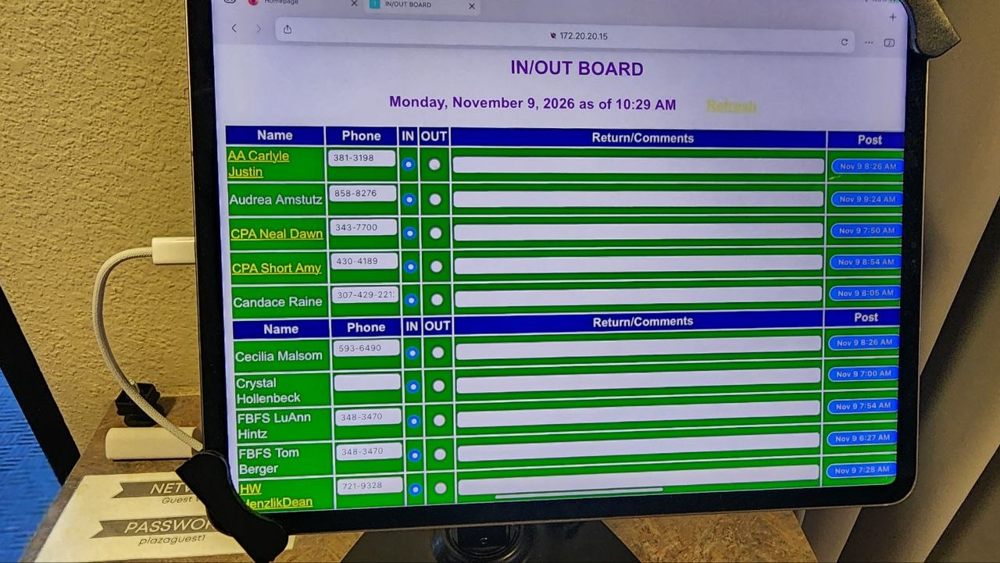

# IN/OUT Board

A multi-tenant **clock in / clock out** board with live status tracking, admin
controls, and global search across all tenants. Built to replace a paper-style
IN/OUT board with a shared, real-time system that anyone in the office can use
from their own device.



---

## What it does

- **Clock in / out** — tap a person to log them as IN or OUT, with an exact
  timestamp recorded every time.
- **Full audit log** — every clock event is stored (who, when, in/out, notes),
  so you can see when someone clocked in and out.
- **Live status board** — shows everyone's current status (IN / OUT) grouped by
  tenant, with their last clock time.
- **Multi-tenant** — add, edit, and remove tenants (departments, offices,
  clients, locations) as separate groups of people.
- **Global search** — the clock interface searches **across all tenants** by
  person name, phone, or tenant name.
- **Admin functionality** — token-protected admin panel for managing tenants,
  people, and reviewing the clock-event history (plus an end-of-day "clock
  everyone out" reset).

---

## How it works (architecture)

| Layer | Technology | Notes |
|-------|-----------|-------|
| Backend | Node.js built-in HTTP server | Zero npm dependencies |
| Database | SQLite via `node:sqlite` | Requires Node.js **22.5+** |
| Frontend | Vanilla HTML / CSS / JS | Served by the same process |
| Auth | Admin accounts (scrypt) + server-side sessions | HttpOnly `SameSite=Strict` cookie; public kiosk at `/` |

### Data model

- **`tenants`** — a group (office, department, client, location) that people
  belong to.
- **`people`** — a person with a name, phone, and tenant assignment.
- **`clock_events`** — an immutable record of a clock-in or clock-out
  (`direction`, `clocked_at`, `notes`).

Current status is *derived* from the most recent clock event per person, so the
audit history is never overwritten.

### API endpoints

| Method | Path | Description | Auth |
|--------|------|-------------|------|
| GET | `/api/health` | Health check | — |
| GET | `/api/tenants` | List tenants | Admin |
| POST | `/api/tenants` | Add tenant | Admin |
| PUT | `/api/tenants/:id` | Edit tenant | Admin |
| DELETE | `/api/tenants/:id` | Delete tenant | Admin |
| GET | `/api/people` | List people (optional `?search=`, `?tenant_id=`) | Admin |
| POST | `/api/people` | Add person | Admin |
| PUT | `/api/people/:id` | Edit person | Admin |
| DELETE | `/api/people/:id` | Delete person | Admin |
| POST | `/api/clock` | Clock a person in/out (`person_id`, `direction`); `409` if already in that state | Public (kiosk) |
| GET | `/api/kiosk/search?q=` | Kiosk name/tenant search; returns only id, name, title, tenant, photo, status (no phone numbers); an empty query returns nothing unless the kiosk is set to *Show everyone* | Public (kiosk) |
| GET | `/api/kiosk/config` | Kiosk layout and mode | Public (kiosk) |
| GET/PUT | `/api/admin/settings` | Read / change `kiosk_layout` (`list`/`cards`/`tiles`/`board`) and `kiosk_mode` (`search`/`browse`) | Admin |
| POST | `/api/auth/login` | Sign in (`username`, `password`) → HttpOnly session cookie; throttled to 8 failures / 15 min / IP | Public |
| POST | `/api/auth/logout` | End the session | Session |
| GET | `/api/auth/me` | Current admin | Session |
| POST | `/api/auth/password` | Change own password (`current`, `next`, min 10 chars) | Admin |
| GET/POST | `/api/admin/users` | List / add admin accounts | Admin |
| DELETE | `/api/admin/users/:id` | Remove an admin (not yourself, not the last one) | Admin |
| GET | `/api/status` | Current status of everyone incl. phone & notes (optional `?search=`, `?tenant_id=`) | Admin |
| GET | `/api/people/:id` | Full profile of one person | Admin |
| PUT/DELETE | `/api/people/:id/photo` | Upload (raw JPEG/PNG/WebP body, max 2 MB) / remove a person's photo | Admin |
| POST | `/api/people/:id/access` | Create or reset a person's sign-in; returns `handle` + one-time `temp_password` | Admin |
| DELETE | `/api/people/:id/access` | Turn a person's sign-in off (ends their sessions) | Admin |
| POST | `/api/me/login` | Person signs in (`handle`, `password`); throttled like admin login | Public |
| POST | `/api/me/logout` | Person signs out | Person |
| GET/PUT | `/api/me` | Own profile: `title`, `phone`, `email`, `bio` (name and tenant are admin-only) | Person |
| PUT/DELETE | `/api/me/photo` | Own photo | Person |
| POST | `/api/me/password` | Change own password (`current`, `next`, min 8 chars) | Person |
| GET | `/api/me/shifts` | Own shifts for the last 30 days | Person |
| GET | `/photos/<file>` | Serve an uploaded photo (unguessable file names) | Public |
| GET | `/api/events` | Clock-event history; filters `tenant_id`, `person_id`, `direction`, `from`, `to` (ms), `limit`, `offset`, `paged=1` | Admin |
| GET | `/api/events.csv` | Same filters, CSV export | Admin |
| POST | `/api/events` | Manual/corrected entry (`person_id`, `direction`, `clocked_at`, `notes`) | Admin |
| DELETE | `/api/events/:id` | Remove a clock event | Admin |
| GET | `/api/sessions` | IN→OUT shifts with durations + total (same filters); open shifts flagged `open` | Admin |
| GET | `/api/sessions.csv` | Shifts as CSV | Admin |
| GET | `/api/admin/overview` | Totals, per-tenant roll-up (people / in / out / time today), recent activity | Admin |
| POST | `/api/reset` | Clock everyone IN → OUT (end of day) | Admin |

---

## Two front doors

| URL | Who | What |
|-----|-----|------|
| `/` | Anyone (kiosk / tablet by the door) | Type your name, tap **IN** or **OUT**. That's all. No phone numbers, no lists, no admin links. |
| `/admin` | Admins only (login required) | The full console below. |

### Admin accounts & security

- Admins sign in at `/admin` with a **username and password** (scrypt-hashed). Sessions are server-side, stored hashed, last 12 hours and ride in an `HttpOnly`, `SameSite=Strict` cookie.
- The first admin is created on first start from `ADMIN_USER` / `ADMIN_PASSWORD`. If `ADMIN_PASSWORD` is not set, a random password is generated and printed once in the server log. Further admins are added under **Admins** in the console, where you can also change your password.
- All tenant, people, status, event and report endpoints require a session. The kiosk can only search names (not phones) and clock IN/OUT.
- Login is throttled, state-changing requests reject cross-origin `Origin` headers, and the old `ADMIN_TOKEN` is gone.
- Behind HTTPS (recommended — e.g. a reverse proxy or Cloudflare tunnel) set `COOKIE_SECURE=1`, or `TRUST_PROXY=1` so `X-Forwarded-Proto/For` are honoured.

## Profiles

Everyone on the board can have a small profile that **they control** and **admins can see and edit**.

- **Photo** — shows next to their name on the kiosk, the live board and the people list (coloured initials if there's no photo). Photos are centre-cropped, resized to 512 px and re-encoded in the browser (which also strips EXIF/location data), then checked on the server by file signature. Only JPEG/PNG/WebP up to 2 MB are accepted; SVG is refused. Files live in `data/uploads/`.
- **Details** — job title, phone, email and a short bio.
- **Their own page at `/me`** — sign in, change the photo and details, see their last 30 days of shifts, change their password.
- **Access is opt-in.** An admin opens a person (the 👤 button on **People**) and clicks **Create sign-in**. That generates a sign-in name (e.g. `dana.whitfield`) and a one-time temporary password, shown once. On first sign-in the person must choose their own password (min 8 characters). **Reset password** issues a new temporary one; **Turn off sign-in** ends their access immediately but keeps the profile.
- **Admins** can edit any profile field, upload or remove any photo, and manage sign-in access. People can't change their own name or tenant, and a person's session can never reach admin endpoints (separate cookie, separate checks).

> Photos are served publicly by an unguessable file name, because the kiosk shows them to anyone standing at it. If that is too open for your site, tell your admins to leave photos off or put the kiosk behind your network/tunnel access rules.

## Layouts

The people on the board can be shown four ways. Pick what suits each screen:

| Layout | Looks like | Good for |
|--------|-----------|----------|
| **List** | One compact row per person | Small screens, simple setups |
| **Cards** | Photo-forward cards in a grid | Recognising people by face |
| **Tiles** | Big colour-coded tiles; the whole tile is the button | Wall tablets and touch screens |
| **Board** | Classic in/out board grouped by tenant, with IN and OUT columns | Anyone used to the paper board |

- **Kiosk:** an admin chooses the layout under **Settings**, and can also choose **Search only** (staff type their name; nobody else is shown) or **Show everyone** (the roster is visible and stays current, grouped by tenant). Add `?layout=tiles` (or `cards`, `board`, `list`) to a tablet's address to override the layout for just that device.
- **Admin Live Board:** a List / Cards / Tiles / Board switch in the toolbar. Each admin's choice is remembered in their browser.
- **Show everyone** exposes names and photos to anyone at the kiosk, so leave it on Search only if that matters at your site.

## Admin dashboard

The admin console has a sidebar:

- **Live Board** — everyone grouped by tenant with phone, status, last clock and notes; auto-refreshes every 30 seconds.
- **Admins** — add/remove admin accounts, change your password.

- **Overview** — people in/out right now, time logged today, a per-tenant table and a live activity feed, plus the end-of-day "clock everyone OUT" action.
- **Tenants** — a card per tenant with people / in / out / time-today. Add, edit and delete tenants in a dialog; jump straight to a tenant's time log.
- **People** — searchable, tenant-filterable table with live status. Add, edit, deactivate and delete people.
- **Time Log** — pick a range (today, this week, last 7 days, month, custom), tenant and person. View **Shifts** (paired IN→OUT with durations; someone still IN shows "so far") or **Raw events**. Export either as CSV. Admins can add a manual entry (e.g. someone forgot to clock out) or delete a bad event.


## Getting started

### Prerequisites

- Node.js **22.5 or later** (for the built-in `node:sqlite` module).

### Run locally

```bash
cd inout-board
ADMIN_USER=jordan ADMIN_PASSWORD='a-long-passphrase' node server.js
```

Then open <http://localhost:3000>.

- **Kiosk** at `/` — public; search your name, tap IN or OUT.
- **Admin console** at `/admin` — sign in with the admin account created on
  first start (`ADMIN_USER` / `ADMIN_PASSWORD`; a random password is printed
  once if you don't set one).

The SQLite database is created automatically at `data/inout.sqlite` (gitignored)
and is seeded with a default **"Main Office"** tenant plus the original board
roster on first run.

### Environment variables

| Variable | Default | Description |
|----------|---------|-------------|
| `PORT` | `3000` | HTTP port |
| `HOST` | `0.0.0.0` | Bind address |
| `ADMIN_USER` | `admin` | Username of the first admin (only used when no admins exist) |
| `ADMIN_PASSWORD` | random, printed once | Password of the first admin |
| `COOKIE_SECURE` | unset | Set `1` to mark the session cookie `Secure` (use behind HTTPS) |
| `TRUST_PROXY` | unset | Set `1` behind a reverse proxy to honour `X-Forwarded-For/Proto` |

---

## Project layout

```
inout-board/
├── server.js          # Backend: HTTP server + SQLite + API
├── package.json
├── .gitignore
├── assets/
│   └── board-design.jpg   # Original design reference photo
├── public/
│   ├── index.html      # Public kiosk (search + IN/OUT)
│   ├── kiosk.js
│   ├── me.html         # Person profile page (served at /me)
│   ├── me.js
│   ├── shared.js       # Avatars + client-side photo resize/upload
│   ├── admin.html      # Admin console shell (served at /admin)
│   ├── app.js          # Admin console logic (login, board, tenants, people, log, admins)
│   └── style.css
└── data/               # SQLite DB + uploads/ photos (created at runtime, gitignored)
```

---

## Deploying

See **[DEPLOY.md](DEPLOY.md)** for Docker, plain Node/systemd, Cloudflare Tunnel, HTTPS, backups/restore and upgrading. `docker compose up -d` is the quickest route. The `deploy` branch also carries a CI workflow (`npm test`) and a workflow that publishes a container image to GitHub Container Registry.

## Deployment notes

The app is intentionally **self-contained and dependency-free** so it can run
anywhere Node.js runs: a small VPS, a Raspberry Pi on the office network, a
container, or a PaaS. For production:

1. Set a strong `ADMIN_PASSWORD` on first start (then add per-person admins and change it).
2. Put it behind HTTPS (reverse proxy such as nginx/Caddy, or the PaaS TLS).
3. Set `COOKIE_SECURE=1` (and `TRUST_PROXY=1` if behind a proxy). Only give admin accounts to trusted staff.

> Deployment target is TBD — the code is being finalized in this repo first,
> before selecting where to host it for presentation.

---

## Status

✅ Core features implemented: multi-tenant clock in/out, SQLite persistence,
live status board, admin panel, and global search.

Next up: deploy to a shared host for live use.
